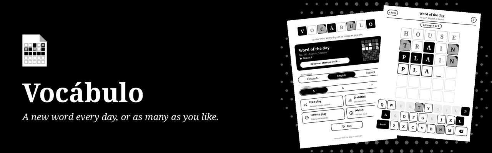
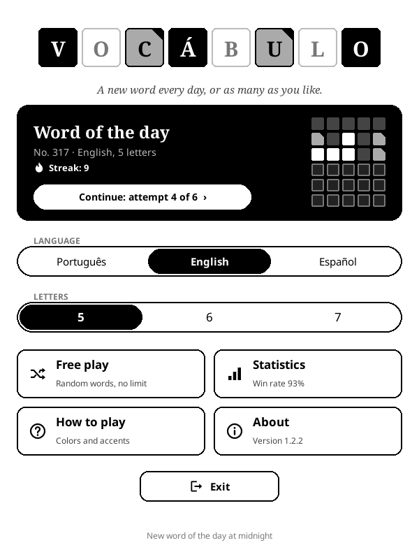
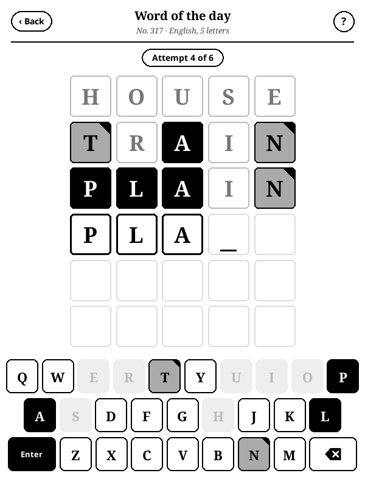
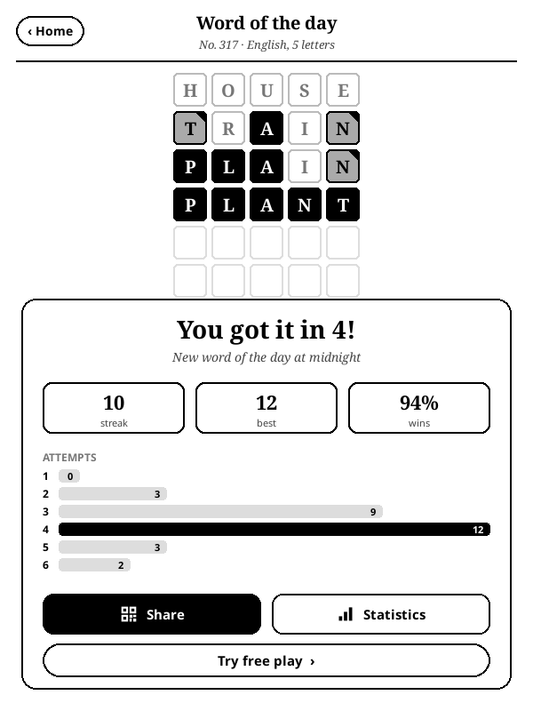
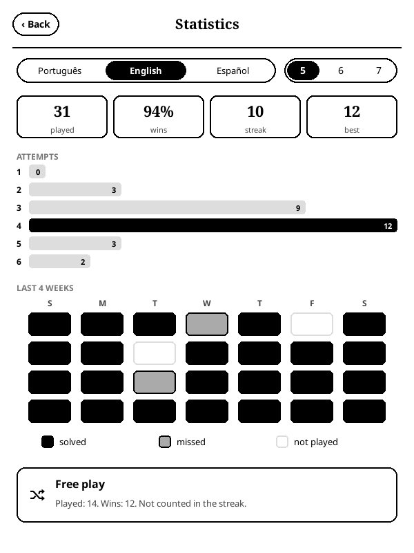

<p align="center">
  
</p>

<p align="center">
  <strong>A new word every day, or as many as you like. A word guessing game for KOReader, in Portuguese, English and Spanish.</strong>
</p>

<p align="center">
  <a href="https://github.com/beater-studios/vocabulo_game.koplugin/releases/latest"></a>
  <a href="https://github.com/beater-studios/vocabulo_game.koplugin/actions/workflows/ci.yml"></a>
  <a href="https://koreader.rocks"></a>
  
  <a href="LICENSE"></a>
</p>

<p align="center">
  <a href="#what-it-does">What it does</a> ·
  <a href="#installation">Installation</a> ·
  <a href="#how-it-works">How it works</a> ·
  <a href="#development">Development</a> ·
  <a href="README_pt.md">Leia em português</a>
</p>

## What it does

<table>
  <tr>
    <td width="25%" align="center"><br><sub><b>Title</b></sub></td>
    <td width="25%" align="center"><br><sub><b>Game</b></sub></td>
    <td width="25%" align="center"><br><sub><b>Result</b></sub></td>
    <td width="25%" align="center"><br><sub><b>Statistics</b></sub></td>
  </tr>
</table>

You have six attempts to find the word. After each one, every letter shows whether it is in the right place, in the word but somewhere else, or not in the word.

- **Word of the day:** everyone playing the same language and length gets the same word, with no internet needed.
- **Free play:** random words, with no daily limit and no effect on your streak.
- **Three languages:** Portuguese, English and Spanish, with 5, 6 or 7 letters. The interface follows the language you pick.
- **Made for e-ink:** black for the right letter, gray with a black corner for a letter in another place and white for a letter that is not in the word, so it does not depend on telling gray from white. The on-screen keyboard uses the same marks.
- **Accents:** you type without accents, and they appear when the word is revealed. In Spanish, Ñ has its own key.
- **Statistics:** games played, win rate, win streak, attempts per game and a calendar of the last four weeks, separate for each language and length, which you can switch without leaving the screen.
- **Sharing:** the daily result shows as a grid of colors with a QR code to read on your phone, without revealing the letters.
- **Sleep screen:** if the device sleeps with the game open, it shows the Vocábulo cover instead of the book cover. This applies when the KOReader sleep screen is set to show the book cover.
- **No internet:** it works offline and collects no data. Progress is saved after every attempt.

## Installation

1. Download `vocabulo_game.koplugin.zip` from the [latest release](https://github.com/beater-studios/vocabulo_game.koplugin/releases/latest).
2. Extract it into `koreader/plugins/`, so that `koreader/plugins/vocabulo_game.koplugin/main.lua` exists.
3. Restart KOReader. The game is in the Tools menu, as **Vocábulo**.

The first time it opens, the language follows KOReader's: Portuguese, English or Spanish. In any other language, it starts in English. After that, the language picked on the title screen is kept.

Progress is kept in `koreader/settings/vocabulo_game.lua`, and KOReader keeps the previous version next to it, as `vocabulo_game.lua.old`. To uninstall, delete the plugin folder and, if you like, those two files.

## How it works

Pick the language and length on the title screen and tap **Play**. Every attempt has to be a real word. A repeated letter is only marked as many times as it appears in the answer. The word of the day changes at midnight, by the device clock, and the daily game is kept until the next day, so you can see the result again.

<details>
<summary><b>The words and free play</b></summary>

<br>

- **Daily words:** 750 for each language and length (744 in Spanish with 5 letters), chosen among the most used words and reviewed one by one. That is more than two years without repeating the word of the day in each combination.
- **Accepted attempts:** from 8 thousand to 49 thousand words per combination, from open dictionaries, including verb forms and plurals.
- **Left out of the answers:** proper names, demonyms, foreign words, rare terms and words that are offensive or heavy to see first thing in the morning, such as violence, illness and politics.
- **Free play:** the draw skips today's word, the words of the next 30 days and the last 30 you played in it. It has its own counter and does not touch your streak.
- **Streak:** goes up with every word of the day you solve on consecutive days, and goes back to zero when you miss one or skip a day.
- **Updates:** a game in progress keeps its answer, so it does not change if a new version brings another list. The daily words already published stay the same, in the same order.

The rules, how the lists are built and the tools are in [docs/design.md](docs/design.md).

</details>

## Compatibility

- Made for KOReader 2026.07 and touch screens, always in portrait. Opened with the device in landscape, the game rotates the screen and restores it on closing. It was developed for a 10th generation basic Kindle (firmware 5.18.1).
- Layout checked in the emulator at 600x800, 758x1024, 1072x1448 and 1264x1680.
- On devices with a Back button, it goes back one screen and, on the title screen, closes the game.
- Uses only what comes with KOReader, with nothing else to install.

## Development

With [LuaJIT](https://luajit.org) and `zip` installed, from the repository root, the same checks as the CI: the word lists, the engine and saved progress tests, the interface texts in the three languages and the package.

```sh
sh tools/check.sh
```

The word lists are built from fixed versions of the sources, checked by checksum, and new words only go in after review. How they are built, the other tools and the release process are in [docs/design.md](docs/design.md). To suggest removing a word, open an issue. Contributions are accepted under the project's license.

## License

The code is under the [GPL-3.0](LICENSE), version 3 only. You may use, study, modify and redistribute it, keeping it open under the same license.

The word lists derive from fserb/pt-br, dwyl/english-words, an-array-of-spanish-words and FrequencyWords. The English and Spanish answers were chosen by FrequencyWords frequencies, under CC BY-SA 4.0, a license compatible with GPL-3.0. Credits and licenses for each source are in [NOTICE](NOTICE).

This license grants no rights to the names "Vocábulo" and "Beater Studios". For other uses, contact [Beater Studios](https://beaterstudios.com/).

---

<p align="center">
  <sub>Made by <a href="https://beaterstudios.com/">Beater Studios</a></sub>
</p>
