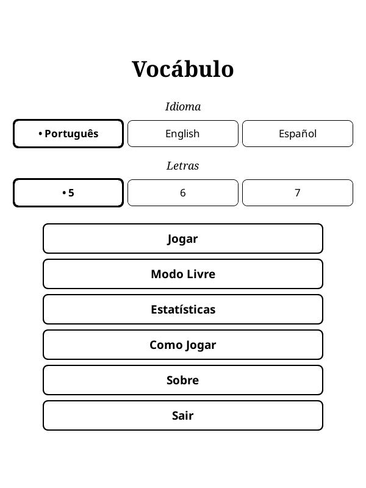
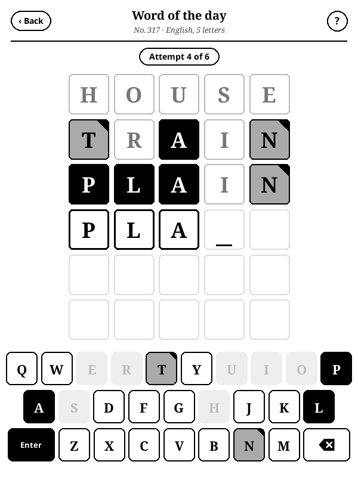
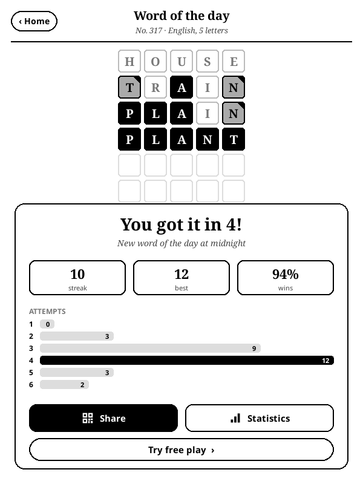

# Vocábulo

[Leia em português](README.md)

A new word every day, or as many as you like. A word guessing game for [KOReader](https://koreader.rocks), in Portuguese, English and Spanish.

A game by [Beater Studios](https://beaterstudios.com/).

| Title | Game | Result |
|---|---|---|
|  |  |  |

## The game

- **Word of the day:** everyone playing the same language and length gets the same word, with no internet needed.
- **Free play:** random words, with no daily limit and no effect on your streak.
- **Three languages:** Portuguese, English and Spanish, with 5, 6 or 7 letters. The interface follows the language you pick.
- **Made for e-ink:** black for the right letter, gray for a letter in another place and white for a letter that is not in the word.
- **Accents:** you type without accents, and they appear when the word is revealed. In Spanish, Ñ has its own key.
- **Statistics:** win streak and attempts by language and length.
- **Sharing:** the daily result becomes a QR code that does not reveal the letters.
- **Sleep screen:** if the device sleeps with the game open, it shows the Vocábulo cover instead of the book cover. This applies when the KOReader sleep screen is set to show the book cover.
- **No internet:** it works offline and collects no data. Progress is saved after every attempt.

## Installation

1. Download `vocabulo_game.koplugin.zip` from the [latest release](https://github.com/beater-studios/vocabulo_game.koplugin/releases/latest).
2. Extract it into `koreader/plugins/`, so that `koreader/plugins/vocabulo_game.koplugin/main.lua` exists.
3. Restart KOReader. The game is in the Tools menu, as **Vocábulo**.

Progress is stored in `koreader/settings/vocabulo_game.lua`. To uninstall, delete the plugin folder and, if you wish, that file.

## Compatibility

- Tested with KOReader 2026.07 on a 10th generation basic Kindle (firmware 5.18.1).
- Layout checked in the emulator at 600x800, 758x1024, 1072x1448 and 1264x1680.
- Requires a touchscreen.
- The game always runs in portrait. Opened in landscape, it rotates the screen and restores the rotation on exit.

## Development

With [LuaJIT](https://luajit.org) installed, from the repository root:

```sh
luajit tools/validate_words.lua
luajit tests/engine_spec.lua
```

The rules, word list generation, remaining tools and release process are described in [docs/design.md](docs/design.md), in Portuguese. To suggest removing a word, open an issue. Contributions are accepted under the project's license.

## License

[GPL-3.0](LICENSE), version 3 only. You may use, study, modify and redistribute it, keeping it open under the same license.

The word lists derive from fserb/pt-br, dwyl/english-words, an-array-of-spanish-words and FrequencyWords. Credits and licenses for each are in [NOTICE](NOTICE).

These terms grant no rights to the names "Vocábulo" and "Beater Studios". For other uses, contact [Beater Studios](https://beaterstudios.com/).
