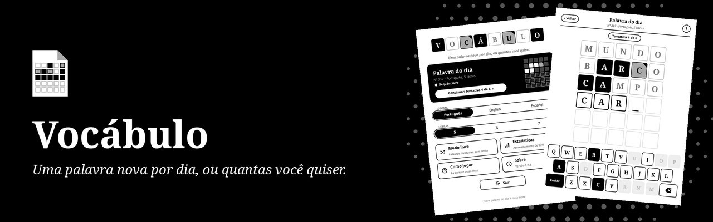
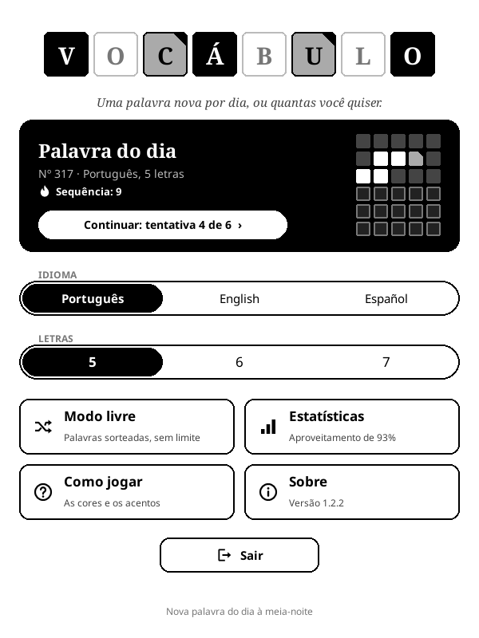
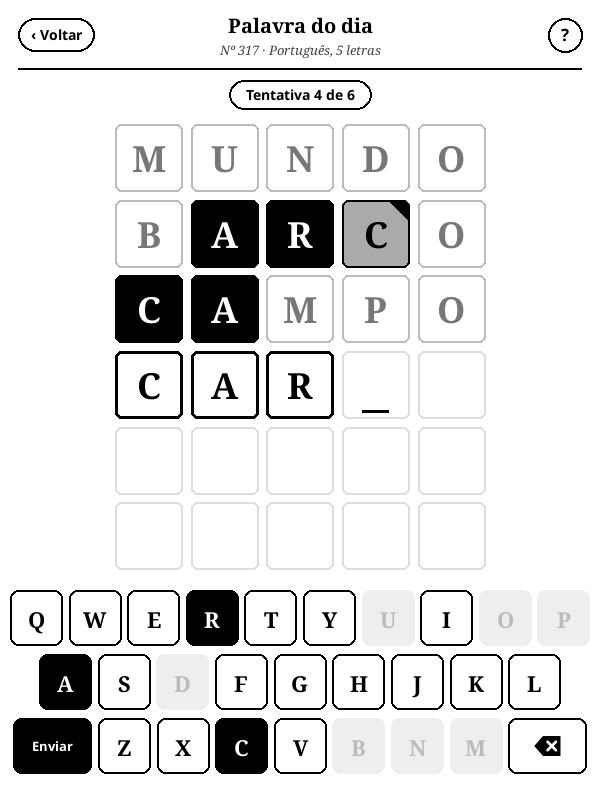
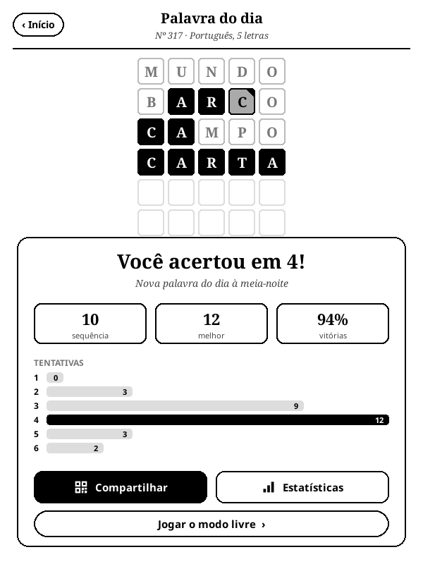
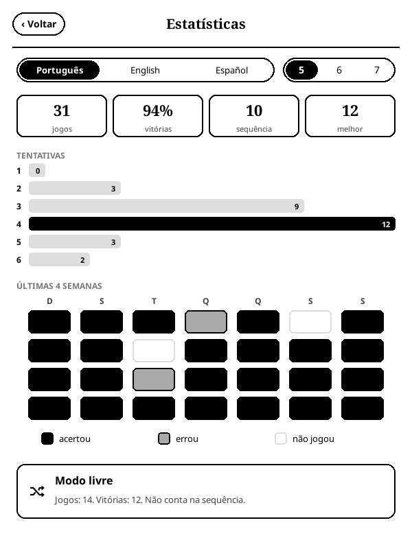

<p align="center">
  
</p>

<p align="center">
  <strong>Uma palavra nova por dia, ou quantas você quiser. Jogo de adivinhar palavras para o KOReader, em português, inglês e espanhol.</strong>
</p>

<p align="center">
  <a href="https://github.com/beater-studios/vocabulo_game.koplugin/releases/latest"></a>
  <a href="https://github.com/beater-studios/vocabulo_game.koplugin/actions/workflows/ci.yml"></a>
  <a href="https://koreader.rocks"></a>
  
  <a href="LICENSE"></a>
</p>

<p align="center">
  <a href="#o-que-ele-faz">O que ele faz</a> ·
  <a href="#instalação">Instalação</a> ·
  <a href="#como-funciona">Como funciona</a> ·
  <a href="#desenvolvimento">Desenvolvimento</a> ·
  <a href="README.md">Read in English</a>
</p>

## O que ele faz

<table>
  <tr>
    <td width="25%" align="center"><br><sub><b>Início</b></sub></td>
    <td width="25%" align="center"><br><sub><b>Partida</b></sub></td>
    <td width="25%" align="center"><br><sub><b>Resultado</b></sub></td>
    <td width="25%" align="center"><br><sub><b>Estatísticas</b></sub></td>
  </tr>
</table>

Você tem seis tentativas para descobrir a palavra. A cada tentativa, cada letra mostra se está no lugar certo, se está na palavra em outro lugar ou se não está na palavra.

- **Palavra do dia:** quem joga com o mesmo idioma e tamanho recebe a mesma palavra, sem precisar de internet.
- **Modo livre:** palavras sorteadas, sem limite por dia e sem mexer na sequência.
- **Três idiomas:** português, inglês e espanhol, com 5, 6 ou 7 letras. A interface acompanha o idioma escolhido.
- **Feito para e-ink:** preto para a letra certa, cinza com um canto preto para a letra em outro lugar e branco para a letra fora da palavra, para não depender de distinguir cinza de branco. O teclado na tela usa as mesmas marcas.
- **Acentos:** você digita sem acento nem cedilha, e eles aparecem quando a palavra é revelada. Em espanhol, o Ñ tem tecla própria.
- **Estatísticas:** jogos, aproveitamento, sequência de vitórias, tentativas por partida e um calendário das últimas quatro semanas, separados por idioma e tamanho, que você troca sem sair da tela.
- **Compartilhar:** o resultado do dia aparece como uma grade de cores com um QR code para ler no celular, sem revelar as letras.
- **Tela de descanso:** se o aparelho dorme com o jogo aberto, aparece a capa do Vocábulo no lugar da capa do livro. Vale quando a tela de descanso do KOReader mostra a capa do livro.
- **Sem internet:** funciona offline e não coleta dados. O progresso é salvo a cada tentativa.

## Instalação

1. Baixe `vocabulo_game.koplugin.zip` na [última release](https://github.com/beater-studios/vocabulo_game.koplugin/releases/latest).
2. Extraia em `koreader/plugins/`, de modo que exista `koreader/plugins/vocabulo_game.koplugin/main.lua`.
3. Reinicie o KOReader. O jogo fica no menu Ferramentas, como **Vocábulo**.

Na primeira abertura, o idioma segue o do KOReader: português, inglês ou espanhol. Em qualquer outro idioma, começa em inglês. Depois, vale o idioma escolhido na tela inicial.

O progresso fica em `koreader/settings/vocabulo_game.lua`, e o KOReader guarda a versão anterior ao lado, como `vocabulo_game.lua.old`. Para desinstalar, apague a pasta do plugin e, se quiser, esses dois arquivos.

## Como funciona

Escolha o idioma e o tamanho na tela inicial e toque em **Jogar**. Cada tentativa precisa ser uma palavra que existe. Uma letra repetida só é marcada tantas vezes quantas aparece na resposta. A palavra do dia muda à meia-noite, pelo relógio do aparelho, e a partida do dia fica guardada até o dia seguinte, para você ver o resultado de novo.

<details>
<summary><b>As palavras e o modo livre</b></summary>

<br>

- **Palavras do dia:** 750 para cada idioma e tamanho (744 em espanhol com 5 letras), escolhidas entre as mais usadas e revisadas uma a uma. São mais de dois anos sem repetir a palavra do dia em cada combinação.
- **Tentativas aceitas:** de 8 mil a 49 mil palavras por combinação, de dicionários abertos, incluindo formas de verbo e plurais.
- **Fora das respostas:** nomes próprios, gentílicos, estrangeirismos, termos raros e palavras ofensivas ou pesadas para ver logo cedo, como violência, doença e política.
- **Modo livre:** o sorteio evita a palavra de hoje, as dos próximos 30 dias e as 30 últimas que você jogou nele. Ele tem contador próprio e não mexe na sequência.
- **Sequência:** sobe a cada palavra do dia acertada em dias seguidos e zera quando você erra ou fica um dia sem jogar.
- **Atualizações:** a partida em andamento guarda a resposta, então não muda se uma versão nova trouxer outra lista. As palavras do dia já publicadas continuam as mesmas, na mesma ordem.

As regras, a geração das listas e as ferramentas estão em [docs/design.md](docs/design.md), em inglês.

</details>

## Compatibilidade

- Feito para o KOReader 2026.07 e para telas sensíveis ao toque, sempre em retrato. Aberto com o aparelho deitado, o jogo gira a tela e devolve a orientação ao fechar. Foi desenvolvido para um Kindle básico da 10ª geração (firmware 5.18.1).
- Layout conferido no emulador em 600x800, 758x1024, 1072x1448 e 1264x1680.
- Em aparelhos com botão Voltar, ele volta uma tela e, no menu, fecha o jogo.
- Usa só o que vem com o KOReader, sem nada mais para instalar.

## Desenvolvimento

Com o [LuaJIT](https://luajit.org) e o `zip` instalados, a partir da raiz do repositório, as mesmas conferências da CI: as listas de palavras, os testes do motor e do progresso salvo, os textos da interface nos três idiomas e o pacote.

```sh
sh tools/check.sh
```

As listas de palavras são geradas a partir de versões fixas das fontes, conferidas por checksum, e as palavras novas só entram depois de revisadas. A geração, as demais ferramentas e o processo de release estão em [docs/design.md](docs/design.md), em inglês. Para sugerir a remoção de uma palavra, abra uma issue. Contribuições são aceitas sob a licença do projeto.

## Licença

O código está sob a [GPL-3.0](LICENSE), somente a versão 3. Você pode usar, estudar, modificar e redistribuir, mantendo-o aberto sob a mesma licença.

As listas de palavras derivam de fserb/pt-br, dwyl/english-words, an-array-of-spanish-words e FrequencyWords. As respostas em inglês e espanhol foram escolhidas pela frequência do FrequencyWords, sob CC BY-SA 4.0, licença compatível com a GPL-3.0. Os créditos e as licenças de cada fonte estão no [NOTICE](NOTICE).

Esta licença não dá direito aos nomes "Vocábulo" e "Beater Studios". Para outros usos, fale com a [Beater Studios](https://beaterstudios.com/).

---

<p align="center">
  <sub>Feito pela <a href="https://beaterstudios.com/">Beater Studios</a></sub>
</p>
